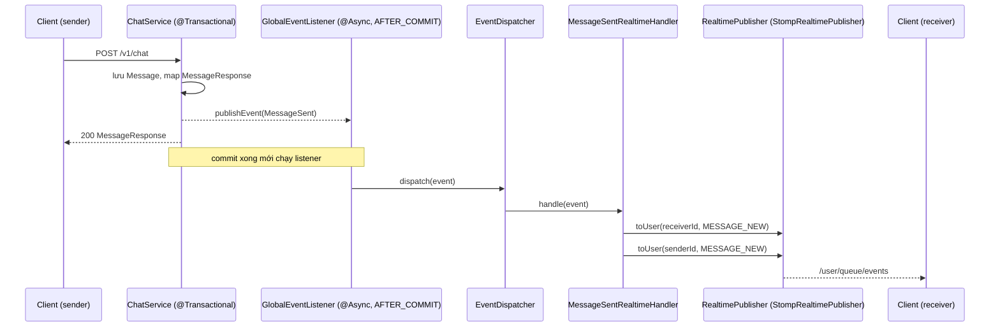

# TutorLink BE: Bàn giao tính năng push realtime qua WebSocket

Tài liệu dành cho người tiếp nhận backend. Phạm vi hiện tại: đẩy sự kiện **chat** (tin mới, đã đọc) từ server xuống client. Tài liệu phía FE nằm ở `websocket-fe-connect.md`.

> **Trạng thái kiểm thử:** code được thiết kế và viết theo review, **chưa được compile hay chạy thử** tại thời điểm bàn giao. Người nhận cần chạy checklist ở mục 8 trước khi merge.

---

## 1. Mục tiêu và nguyên tắc

- WebSocket chỉ dùng để **đẩy từ server xuống client** (outbound). Client vẫn gửi tin bằng `POST /v1/chat` và đánh dấu đã đọc bằng `PATCH /v1/chat/channels/{id}/read`, vì REST đã có validate và transaction.
- **DB là nguồn sự thật.** Push có thể mất (không replay). Client reconnect thì gọi lại REST để đồng bộ.
- Service nghiệp vụ **không biết gì về WebSocket**. Nó chỉ publish domain event.

## 2. Luồng xử lý



Đánh dấu đã đọc: `ChatService.markChannelAsRead` publish `MessagesRead` (chỉ khi có tin được cập nhật) rồi push `MESSAGE_READ` cho **đối phương**.

## 3. Danh sách file

### Mới

| File | Vai trò |
|---|---|
| `common/ws/realtime/RealtimeEventType.java` | Enum loại sự kiện: `MESSAGE_NEW`, `MESSAGE_READ` |
| `common/ws/realtime/RealtimeEvent.java` | Envelope gửi xuống client: `type`, `occurredAt`, `data` |
| `common/ws/realtime/RealtimeDestinations.java` | Hằng số đích STOMP (`/queue/events`) |
| `common/ws/realtime/RealtimePublisher.java` | Port: `toUser`, `toTopic` |
| `common/ws/realtime/StompRealtimePublisher.java` | Adapter dùng `SimpMessagingTemplate`, nơi duy nhất biết STOMP |
| `features/chat/event/MessageSent.java` | Domain event tin mới (chứa snapshot `MessageResponse`) |
| `features/chat/event/MessagesRead.java` | Domain event đã đọc |
| `features/chat/realtime/MessageSentRealtimeHandler.java` | Dịch `MessageSent` thành `MESSAGE_NEW`, push cho người nhận và người gửi |
| `features/chat/realtime/MessagesReadRealtimeHandler.java` | Dịch `MessagesRead` thành `MESSAGE_READ`, push cho đối phương |

### Sửa

| File | Thay đổi |
|---|---|
| `common/ws/handler/EventDispatcher.java` | `Map<Class, EventHandler>` đổi thành `Map<Class, List<EventHandler>>`; try/catch từng handler |
| `features/chat/service/ChatService.java` | Inject `ApplicationEventPublisher`; publish `MessageSent` trong `sendMessage`, `MessagesRead` trong `markChannelAsRead` (thay hai `TODO(WS)`) |
| `common/security/ws/MessageSecurityConfig.java` | Bỏ rule subscribe `/topic/conversations/**` và `/topic/conversation/**`; `hasRole("ADMIN")` đổi thành `hasAuthority("ADMIN")` |

### Có sẵn, không đổi

`WebSocketConfiguration`, `StompAuthChannelInterceptor`, `GlobalEventListener`, `DomainEvent`, `EventHandler`, `AsyncConfig`.

## 4. Hợp đồng sự kiện (server gửi xuống)

Đích: client subscribe **`/user/queue/events`** (không kèm userId, Spring tự định tuyến theo principal).

Envelope:

```json
{
  "type": "MESSAGE_NEW",
  "occurredAt": "2026-11-11T08:00:00Z",
  "data": { }
}
```

| `type` | `data` | Gửi cho |
|---|---|---|
| `MESSAGE_NEW` | `MessageResponse`: `id`, `chatChannelId`, `senderId`, `content`, `sentAt`, `mediaList` (cùng cấu trúc với `GET /v1/chat/channels/{id}/messages`) | Người nhận **và** người gửi (đồng bộ nhiều tab) |
| `MESSAGE_READ` | `{ channelId, readerId, readAt }` | Đối phương của người vừa đọc |

Ghi chú:
- Người gửi nhận lại chính tin của mình. FE phải **dedupe theo `data.id`**.
- Định dạng thời gian do Jackson cấu hình; cần xác nhận thực tế là chuỗi ISO-8601 khi test (mục 8).

## 5. Bảo mật

- Xác thực ở frame STOMP `CONNECT` bằng header `Authorization: Bearer <accessToken>` (`StompAuthChannelInterceptor`). Thiếu hoặc sai token thì kết nối bị từ chối.
- Principal name của phiên = JWT subject = `userId`. `StompRealtimePublisher.toUser` dùng đúng giá trị này.
- **Không phát tin chat lên `/topic/...`**. Chỉ dùng user queue, nên người khác không thể đoán channelId để nghe lén.
- `MessageSecurityConfig` hiện cho phép: subscribe `/user/queue/**` (authenticated), `/topic/orders/**` (authenticated), `/topic/admin/**` (`hasAuthority("ADMIN")`), gửi `/app/**` (authenticated); còn lại `denyAll`.

## 6. Cách thêm một loại push mới

1. Thêm giá trị vào `RealtimeEventType`.
2. Tạo record event implements `DomainEvent`, chứa **snapshot** (DTO hoặc id), **không chứa entity**. Handler chạy `@Async` sau commit nên không còn Hibernate session (tránh `LazyInitializationException`).
3. Tạo `@Component` implements `EventHandler<YourEvent>`: `support()` trả class event, `handle()` gọi `RealtimePublisher`.
4. Trong service, `eventPublisher.publishEvent(...)` **bên trong `@Transactional`**. `@TransactionalEventListener(AFTER_COMMIT)` sẽ bỏ qua event publish ngoài transaction.

Không cần sửa `EventDispatcher`, `GlobalEventListener` hay `StompRealtimePublisher`. Nhiều handler cho cùng một event được phép (ví dụ vừa push WS vừa ghi Notification).

## 7. Cấu hình và triển khai

- Endpoint: `/ws` (SockJS), cộng context-path `/api`, nên URL thực là `{host}/api/ws`.
- Broker: **simple broker trong bộ nhớ** (`/topic`, `/queue`), prefix user `/user`, prefix ứng dụng `/app`.
- Executor handler: `taskExecutor` (core 5, max 20, queue 50). Nếu queue đầy, event sẽ bị trễ hoặc từ chối.
- **Chỉ đúng khi chạy một instance.** Muốn scale ngang thì thay `StompRealtimePublisher` bằng adapter dùng broker relay (RabbitMQ STOMP hoặc Redis pub/sub). Handler và service không cần đổi vì chỉ phụ thuộc port `RealtimePublisher`.

## 8. Checklist kiểm thử trước khi merge

- [ ] Project compile (`ChatService` dùng `Instant`, `MessageResponse`, `ChatChannel`: kiểm tra import).
- [ ] App khởi động không lỗi `EventDispatcher` (trước đây trùng handler cho một event sẽ làm crash).
- [ ] Hai user (tutor, student) cùng kết nối, subscribe `/user/queue/events`.
- [ ] Student `POST /v1/chat`: tutor nhận `MESSAGE_NEW`; student cũng nhận một bản.
- [ ] Tutor gọi `PATCH .../read`: student nhận `MESSAGE_READ`. Gọi lần hai khi không còn tin chưa đọc thì **không** có event.
- [ ] User thứ ba subscribe `/user/queue/events` không nhận được gì của hai người kia.
- [ ] Kết nối không kèm token bị từ chối.
- [ ] Kiểm tra định dạng `sentAt`, `occurredAt`, `readAt` trong JSON.
- [ ] Một handler ném exception không làm hỏng handler khác (log `Handler ... failed`).

## 9. Giới hạn đã biết và việc tồn đọng

Thuộc tính năng WS:
- **Không replay:** event gửi lúc client offline sẽ mất. FE phải refetch (`channels`, `unread-count`) sau mỗi lần reconnect.
- **Token hết hạn:** phiên WS không bị đóng khi access token hết hạn (chỉ kiểm tra lúc `CONNECT`). FE tự chịu trách nhiệm reconnect bằng token mới.
- **Heartbeat STOMP:** `WebSocketConfiguration` chưa cấu hình heartbeat/`TaskScheduler` cho simple broker. SockJS có heartbeat riêng, nhưng nếu đi qua proxy/load balancer có idle timeout thì nên bổ sung.
- Chưa có typing indicator, presence online/offline, và `NOTIFICATION_NEW` (các bước sau dùng lại đúng cơ chế mục 6).

Phát hiện khi đọc code, **ảnh hưởng gián tiếp** tới WS, chưa được sửa trong đợt này:
- **Refresh token:** `JwtService.generateRefreshToken` lưu Redis với giá trị `userId`, nhưng `AuthenticationService.refreshToken()` tra user bằng `findByEmail(...)`. Token cấp lúc login và token cấp từ lần refresh sẽ lỗi `UserNotFound`. Điều này ảnh hưởng tới việc FE lấy token mới để reconnect WS.
- `WebSocketConfiguration` đang `setAllowedOriginPatterns("http://localhost:5173", "*")` (thực tế là cho mọi origin). `app.cors.allowed-origins` mặc định `*` kèm `allowCredentials(true)`. Nên siết lại ở môi trường production.
- `logging.level.org.springframework.security=DEBUG` đang bật trong `application.properties`.
- `StompAuthChannelInterceptor` log `INFO` cho mọi frame STOMP, gồm cả thông tin user; cân nhắc hạ mức log ở production.
