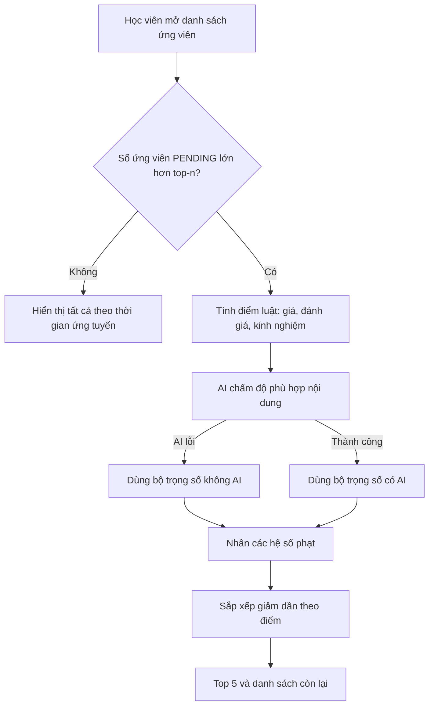

# TutorLink: Xếp hạng gia sư ứng tuyển (Matching)

Tài liệu mô tả nghiệp vụ, tiêu chí chấm điểm, trọng số và cấu hình của tính năng
**gợi ý top gia sư phù hợp nhất** cho học viên.

> Các giá trị số trong tài liệu là giá trị khởi điểm trong `application.properties`.
> Nếu bạn chỉnh cấu hình, hãy cập nhật lại các bảng bên dưới.

---

## 1. Nghiệp vụ

1. Học viên đăng bài **tìm gia sư** (`PostType.FIND_TUTOR`): môn, cấp học, hình thức dạy,
   địa chỉ, ngân sách (kèm đơn vị), số buổi mỗi tuần, thời lượng mỗi buổi, nội dung mô tả.
2. Gia sư ứng tuyển vào bài đăng, kèm lời nhắn và (tùy chọn) mức phí đề xuất.
3. Khi học viên mở danh sách ứng viên:
    - **Từ `top-n` ứng viên trở xuống (mặc định 5)**: hiển thị tất cả, sắp theo thời gian ứng tuyển, không chấm điểm.
    - **Nhiều hơn `top-n`**: hệ thống chấm điểm, trả về **top 5 phù hợp nhất** và danh sách **còn lại**.
      Học viên vẫn xem được toàn bộ gia sư còn lại, AI chỉ quyết định thứ tự hiển thị, không ẩn ai.
4. Xếp hạng **không thay đổi trạng thái** ứng tuyển. Việc chọn, xác nhận, từ chối vẫn đi theo luồng cũ
   (`select`, `confirm`, `reject`).

### Phạm vi và phân quyền

| Điều kiện | Kết quả |
|---|---|
| Người gọi không phải học viên | Bị chặn bởi `@PreAuthorize("hasAuthority('STUDENT')")` |
| Bài đăng không tồn tại | `POST_NOT_FOUND` |
| Bài đăng không phải `FIND_TUTOR` | `POST_NOT_AVAILABLE` |
| Người gọi không phải tác giả bài đăng | `APPLICATION_NOT_ALLOWED` |
| Chỉ xét ứng tuyển ở trạng thái | `PENDING` |

---

## 2. Luồng xử lý



---

## 3. Công thức điểm

```
điểm = ( w_giá × giá + w_đánh_giá × đánh_giá + w_kinh_nghiệm × kinh_nghiệm + w_nội_dung × nội_dung )
       × Π (hệ số phạt của từng điều kiện không khớp)
```

Mọi tiêu chí thành phần đều nằm trong khoảng **0 đến 1**.

### 3.1. Tiêu chí thành phần

| Tiêu chí | Cách tính |
|---|---|
| **Giá** | So **phí hiệu lực** của gia sư với ngân sách `minBudget`..`maxBudget` của bài đăng (xem 3.2) |
| **Đánh giá** | Trung bình Bayesian của điểm đánh giá, chia cho thang tối đa (5) |
| **Kinh nghiệm** | `min(số năm kinh nghiệm / experience-cap-years, 1)` |
| **Nội dung (AI)** | Gemini chấm 0..100 độ phù hợp giữa nội dung bài đăng và hồ sơ + lời nhắn của gia sư, chia 100 |

### 3.2. Điểm giá chi tiết

**Phí hiệu lực** là phí gia sư đề xuất cho bài này (`Application.proposedFee`). Nếu không có thì
lấy `Tutor.hourlyRate` và **quy đổi về đơn vị ngân sách của bài đăng** (`Post.budgetUnit`):

| `budgetUnit` | Phí hiệu lực khi dùng giá theo giờ trong hồ sơ |
|---|---|
| `PER_HOUR` | `hourlyRate` |
| `PER_SESSION` | `hourlyRate × durationMinutes / 60` |
| `PER_MONTH` | `hourlyRate × durationMinutes / 60 × sessionsPerWeek × weeks-per-month` |

Thiếu dữ liệu để quy đổi thì coi như không có phí (chấm trung tính).

Điểm giá theo vị trí của phí so với ngân sách:

| Trường hợp | Điểm |
|---|---|
| Không có ngân sách hoặc không có phí | `no-budget-score` (0.5) |
| Nằm trong `[minBudget, maxBudget]` | 1.0 |
| Thấp hơn `minBudget` | `below-budget-score` (0.8), phạt nhẹ vì rẻ bất thường có thể là thiếu kinh nghiệm |
| Cao hơn `maxBudget` | `max(0, 1 - (phí - maxBudget) / maxBudget)`, giảm dần theo mức vượt |

### 3.3. Điểm đánh giá: trung bình Bayesian

```
bayesian = (n × avg + m × C) / (n + m)
đánh_giá = bayesian / max-rating
```

- `n`: số lượt review của gia sư, `avg`: điểm trung bình của gia sư.
- `m` = `min-votes` (5), `C` = `global-avg-rating` (4.0).

Gia sư ít review bị kéo về mức trung bình hệ thống, nên **1 review 5 sao không vượt gia sư 100 review 4.8 sao**,
và gia sư mới chưa có review nhận mức trung tính (0.8) thay vì 0.

### 3.4. Điểm nội dung (AI)

- Dùng `ChatClient` của Spring AI (cấu hình `spring.ai.google.genai.*`).
- AI nhận khối `<POST>` (tiêu đề, nội dung, môn, cấp học) và các khối `<CANDIDATE>`
  (môn dạy, kinh nghiệm, học vấn, giới thiệu, lời nhắn ứng tuyển).
- **Không gửi** tên, email, số điện thoại, địa chỉ, giới tính, tuổi.
- Kết quả được kiểm tra: bỏ id lạ do AI tự bịa, ép điểm về khoảng 0..100.
- Chỉ gọi **một lần** cho cả danh sách ứng viên, và chỉ khi có nhiều hơn `top-n` ứng viên.
- Nếu AI lỗi hoặc hết thời gian, hệ thống tự dùng **bộ trọng số không AI**, học viên không thấy lỗi.

---

## 4. Trọng số

Mỗi bộ trọng số nên có **tổng bằng 1.0**.

| Tiêu chí | Có điểm AI (`ai-weights`) | Không có AI (`weights`) |
|---|---|---|
| Giá | 0.30 | 0.40 |
| Đánh giá | 0.25 | 0.35 |
| Kinh nghiệm | 0.15 | 0.25 |
| Nội dung (AI) | 0.30 | 0.00 |

AI chiếm tối đa 30% để một nội dung hồ sơ viết khéo (hoặc cố tình cài lệnh vào lời nhắn)
không thể lật hoàn toàn thứ hạng.

---

## 5. Hệ số phạt

Các điều kiện dưới đây **không loại** gia sư, chỉ nhân điểm xuống để họ xuống cuối danh sách.
Nhiều điều kiện không khớp thì các hệ số **nhân dồn** với nhau (sai cả môn lẫn cấp: 0.3 × 0.5 = 0.15).

| Cảnh báo (`MatchWarning`) | Khi nào xảy ra | Hệ số |
|---|---|---|
| `SUBJECT_MISMATCH` | Gia sư không dạy môn của bài đăng (`Tutor.subjects` không chứa `Post.subject`) | 0.3 |
| `LEVEL_MISMATCH` | `Tutor.teachingLevels` không chứa cấp học của bài đăng | 0.5 |
| `MODE_MISMATCH` | Hình thức dạy hai bên không giao nhau (`BOTH` khớp với mọi giá trị) | 0.5 |
| `AREA_MISMATCH` | Bài đăng dạy **trực tiếp** và khu vực dạy của gia sư không chứa phường/tỉnh của bài đăng | 0.6 |
| `AVAILABILITY_MISMATCH` | Tổng số buổi tối đa trong lịch rảnh nhỏ hơn `sessionsPerWeek` | 0.6 |

### Quy tắc dữ liệu thiếu: luôn trung tính

Gia sư cũ hoặc hồ sơ chưa điền đủ **không bị phạt**.

| Dữ liệu thiếu | Hành vi |
|---|---|
| `teachingLevels` rỗng hoặc bài đăng không có cấp học | Không phạt cấp học |
| `teachingMode` hoặc `Post.teachingMode` null | Không phạt hình thức |
| `teachingAreas` rỗng hoặc bài đăng không có địa chỉ | Không phạt khu vực |
| `availableSlots` rỗng hoặc bài đăng thiếu số buổi hoặc thời lượng | Không phạt lịch |
| Không có ngân sách hoặc không có phí | Điểm giá 0.5 |

### Chi tiết từng điều kiện

- **Khu vực**: chỉ xét khi bài đăng là `OFFLINE` và gia sư không phải `ONLINE` (nếu gia sư chỉ dạy online thì đã bị
  `MODE_MISMATCH`, không phạt chồng). So khớp trên `ward` và `province`, bỏ dấu, không phân biệt hoa thường,
  khớp khi chuỗi này chứa chuỗi kia. `street` không dùng.
- **Lịch rảnh**: mỗi khung rảnh chứa được `floor(số phút khung / durationMinutes)` buổi, cộng tất cả các khung và so với
  `sessionsPerWeek`. Hiện **chưa** kiểm tra trùng đúng khung giờ vì bài đăng chưa có khung giờ mong muốn.

---

## 6. Sắp xếp

1. Điểm giảm dần.
2. Bằng điểm thì **ứng tuyển sớm hơn** xếp trước.
3. 5 người đầu vào `top`, phần còn lại vào `others` (vẫn theo thứ tự điểm).

---

## 7. Ví dụ tính điểm

Bài đăng: lớp 9, Toán, ngân sách 150.000 đến 250.000 / giờ. Có AI.

| | Gia sư A | Gia sư B |
|---|---|---|
| Phí | 200.000 (trong ngân sách) | 100.000 (thấp hơn mức tối thiểu) |
| Giá | 1.0 | 0.8 |
| Đánh giá | 4.8 sao, 20 review: (20×4.8 + 5×4.0) / 25 = 4.64, chia 5 = **0.928** | Chưa có review: 4.0 chia 5 = **0.8** |
| Kinh nghiệm | 5 năm = 0.5 | 10 năm = 1.0 |
| Nội dung (AI) | 0.85 | 0.90 |
| Điểm cơ bản | 0.30×1.0 + 0.25×0.928 + 0.15×0.5 + 0.30×0.85 = **0.862** | 0.30×0.8 + 0.25×0.8 + 0.15×1.0 + 0.30×0.90 = **0.860** |
| Cảnh báo | Không | `LEVEL_MISMATCH` (chưa dạy lớp 9), nhân 0.5 |
| **Điểm cuối** | **0.862** | **0.430** |

Dù B có điểm cơ bản gần bằng A, việc chưa dạy cấp học này kéo B xuống cuối danh sách.

---

## 8. API

`GET /v1/applications/post/{postId}/ranked`

```json
{
  "ranked": true,
  "top": [
    {
      "application": { "id": "...", "message": "...", "proposedFee": 200000 },
      "score": 0.862,
      "breakdown": {
        "price": 1.0,
        "rating": 0.928,
        "experience": 0.5,
        "experienceYears": 5,
        "semantic": 0.85
      },
      "warnings": []
    }
  ],
  "others": [
    {
      "application": { "...": "..." },
      "score": 0.43,
      "breakdown": { "...": "..." },
      "warnings": ["LEVEL_MISMATCH"]
    }
  ]
}
```

- Từ `top-n` ứng viên trở xuống: `ranked = false`, `top` chứa tất cả, `others` rỗng, và `score`, `breakdown`, `warnings` không có trong JSON.
- `breakdown.semantic = null` nghĩa là lần này AI không chấm được (đã dùng bộ trọng số không AI).
- Backend **không sinh câu chữ hiển thị**. Frontend dịch `warnings` theo khóa:

```json
{
  "SUBJECT_MISMATCH": "Khác môn",
  "LEVEL_MISMATCH": "Chưa dạy cấp này",
  "MODE_MISMATCH": "Khác hình thức dạy",
  "AREA_MISMATCH": "Ngoài khu vực dạy của gia sư",
  "AVAILABILITY_MISMATCH": "Lịch rảnh chưa đủ số buổi mỗi tuần"
}
```

Gợi ý hiển thị: nên dùng nhãn "Gợi ý phù hợp" và thứ hạng, hoặc phần trăm (87%), thay vì số thập phân 0.87.

---

## 9. Cấu hình (`application.properties`)

```properties
# --- AI ---
app.ai.prompt.path.tutor-matching=prompts/tutor-matching.txt
app.ai.prompt.path.tutor-matching-system=prompts/tutor-matching-system.txt
app.ai.prompt.path.tutor-matching-post=prompts/tutor-matching-post.txt
app.ai.prompt.path.tutor-matching-candidate=prompts/tutor-matching-candidate.txt
app.ai.matching.max-score=100
app.ai.matching.max-text-length=600

# --- Xếp hạng ---
app.matching.top-n=5
app.matching.global-avg-rating=4.0
app.matching.min-votes=5
app.matching.max-rating=5.0
app.matching.experience-cap-years=10
app.matching.weeks-per-month=4

app.matching.weights.price=0.40
app.matching.weights.rating=0.35
app.matching.weights.experience=0.25
app.matching.weights.semantic=0.0

app.matching.ai-weights.price=0.30
app.matching.ai-weights.rating=0.25
app.matching.ai-weights.experience=0.15
app.matching.ai-weights.semantic=0.30

app.matching.penalty.subject=0.3
app.matching.penalty.level=0.5
app.matching.penalty.mode=0.5
app.matching.penalty.area=0.6
app.matching.penalty.availability=0.6

app.matching.price.no-budget-score=0.5
app.matching.price.below-budget-score=0.8

# Nạp các collection lazy của Tutor theo lô, tránh N+1
spring.jpa.properties.hibernate.default_batch_fetch_size=50
```

Thiếu một khóa bắt buộc thì ứng dụng báo lỗi ngay lúc khởi động, không chạy với giá trị 0 một cách âm thầm.
Chỉnh cấu hình cần **khởi động lại** ứng dụng.

### Cách chỉnh ưu tiên

| Mục tiêu | Chỉnh |
|---|---|
| Để nội dung bài đăng quyết định nhiều hơn | Tăng `ai-weights.semantic`, giảm các trọng số khác cho tổng vẫn bằng 1.0 |
| Học viên nhạy cảm về học phí | Tăng `ai-weights.price` |
| Siết chặt về chuyên môn | Giảm `penalty.subject` và `penalty.level` |
| Đưa nhiều gia sư hơn vào danh sách gợi ý | Tăng `top-n` |

---

## 10. Cấu trúc mã nguồn

```
common/config/
├── MatchingProperties.java            Cấu hình xếp hạng (prefix app.matching)
└── PromptLoader.java                  Đọc prompt từ file trong classpath

features/ai/
├── dto/response/TutorMatchScore.java  Kết quả AI trả về cho một ứng viên
├── exception/ErrorCodeAi.java         AI_PROVIDER_ERROR (502)
└── service/TutorMatchingAiService.java  Gọi Gemini, kiểm tra và chuẩn hóa điểm

features/application/
├── controller/ApplicationController.java        Endpoint GET /post/{postId}/ranked
├── dto/response/                                 RankedApplicationsResponse, ScoredApplicationResponse, MatchBreakdown
├── enums/MatchWarning.java                       Các cảnh báo không khớp
├── matching/AreaMatcher.java                     Kiểm tra khu vực dạy
├── matching/AvailabilityChecker.java             Kiểm tra lịch rảnh
└── service/impl/ApplicationRankingServiceImpl.java  Điều phối và chấm điểm

resources/prompts/
├── tutor-matching-system.txt
├── tutor-matching.txt
├── tutor-matching-post.txt
└── tutor-matching-candidate.txt
```

---

## 11. Dữ liệu đầu vào được dùng

| Nguồn | Trường |
|---|---|
| `Post` | `type`, `author`, `title`, `content`, `subject`, `educationLevel`, `teachingMode`, `address` (ward, province), `minBudget`, `maxBudget`, `budgetUnit`, `sessionsPerWeek`, `durationMinutes` |
| `Tutor` | `bio`, `education`, `experienceYears`, `hourlyRate`, `averageRating`, `subjects`, `teachingLevels`, `teachingMode`, `teachingAreas`, `availableSlots` |
| `Application` | `message`, `proposedFee`, `appliedAt`, `applicationStatus` |
| `Review` | Số lượt review của từng gia sư (đếm một lần cho cả danh sách) |

Tên, giới tính, tuổi, ảnh đại diện và thông tin liên hệ **không** được dùng để chấm điểm.

---

## 12. Bảo mật và công bằng

- **Prompt injection**: bio và lời nhắn do gia sư tự viết. Hệ thống cắt ngắn, thay ký tự `<` `>`,
  dặn AI coi nội dung là dữ liệu, và giới hạn AI ở 30% điểm.
- **Quyền riêng tư**: prompt chỉ có nội dung chuyên môn và id ứng tuyển.
- **Gia sư mới** không bị thiệt: thiếu dữ liệu luôn được chấm trung tính.
- **Minh bạch**: học viên xem được toàn bộ ứng viên, kèm `breakdown` và `warnings` để hiểu vì sao xếp như vậy.

---

## 13. Giới hạn hiện tại và hướng phát triển

- Chưa kiểm tra trùng đúng khung giờ (bài đăng chưa có lịch mong muốn).
- Chưa tính khoảng cách địa lý, chỉ so khớp tên phường và tỉnh.
- `teachingAreas` là chuỗi tự do nên nên cho chọn từ danh sách chuẩn cùng nguồn với `Address`.
- Mỗi lần mở danh sách có hơn `top-n` ứng viên là một lần gọi AI. Nên cache theo `postId` và danh sách id ứng viên (Redis).
- Chưa kiểm tra tổng trọng số bằng 1.0 khi khởi động.
- Nên theo dõi gia sư nào trong top 5 được học viên chọn để tinh chỉnh trọng số theo dữ liệu thực tế.